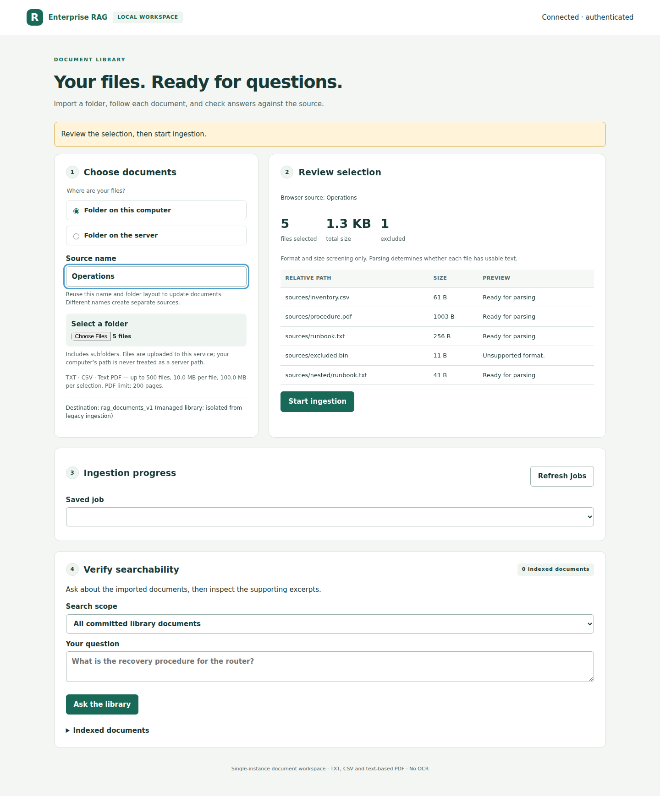

# Enterprise RAG Platform

Select a folder, ask questions about its documents, and inspect the source passages
behind each answer. The app uses a local model and a browser interface.



*Example content from a synthetic test, not a screenshot of real-model answers.*

## System requirements

- **Ubuntu 22.04 or 24.04, x86-64**, with Bash and Python 3.10+. These are installer
  targets, not yet verified real-model platform support. Windows 11/WSL2 remains
  unverified; Apple Silicon installation is deferred.
- **Docker Engine and Compose v2 or newer**, with Docker running.
  [Ubuntu Docker installation](https://docs.docker.com/engine/install/ubuntu/) ·
  [Windows WSL2 setup](https://docs.docker.com/desktop/features/wsl/)
- **Git** to download the project (installation commands below).
- Internet access for the first build and model downloads. An NVIDIA GPU is
  strongly recommended. Setup checks access inside Docker; CPU mode is available
  with a warning, but its real-model latency has not been validated.

Setup starts the API/browser UI, Qdrant and Ollama in separate containers. You do
not need to install Qdrant or Ollama separately. The defaults are chat model
`qwen3:8b` and embedding model `nomic-embed-text:latest`, used in the earlier small
live test. An existing Ollama server is an [advanced option](docs/setup.md#external-ollama).

<a id="docker-browser-quickstart"></a>

## Install and open

Open a terminal on the Ubuntu machine that will run the application. First check
that Git, the tool used to download the project, is installed:

```sh
git --version
```

If this reports `command not found`, install Git, then continue:

```sh
sudo apt update
sudo apt install git
```

Download (clone) the project and enter its folder:

```sh
git clone https://github.com/athollywood2002/enterprise-rag-platform.git "$HOME/rag" &&
  cd "$HOME/rag"
```

This creates a `rag` folder in your home directory (`~/rag`). No GitHub account or
access token is needed for this public repository. If that folder already exists
and is not empty, stop and use a different new folder name in both commands; do not
delete an existing installation. Keep this folder: it holds the setup files and
installation configuration used for stopping and resuming the application.

Once the download succeeds, read `setup.sh` and its helper `scripts/install.py`
in that folder, then start setup from the same terminal:

```sh
bash setup.sh
```

The first run builds the API and downloads missing models into this installation's
own volume. When services are ready, open the printed browser URL. Setup checks
metadata, not answer generation. To get the application key for **Connect**, run:

```sh
bash setup.sh --show-key
```

This prints the existing key only to a terminal. Copy it into **API key**, then click
**Connect**. Do not include the key in screenshots or troubleshooting output.
For a headless server, use the [SSH tunnel instructions](docs/setup.md#headless-server).

## Try a small folder

1. Choose **Folder on this computer**, enter a source name, and select a folder of
   TXT, CSV or text-based PDF files. `demo/fixtures` is a small example.
2. Review the filenames, sizes and exclusions. Click **Start ingestion**.
3. Wait for the files to complete. On a repeat import, **skipped / unchanged** means
   the existing index was verified. Read the detail for other skips or failures.
4. Choose **Documents from the selected job**, ask something you can check in the
   files, and inspect **Cited sources**, including PDF page numbers.

You can refresh, reconnect with the same key and reopen the saved job. Scans need
OCR before import. See the [illustrated walkthrough](docs/ui-walkthrough.md).

<a id="4-stop-and-retain-the-library"></a>

## Stop and resume

```sh
bash setup.sh --stop
```

Documents, job history and downloaded models remain in this installation's volumes.
Run `bash setup.sh` to resume without refreshing models or rebuilding the API.

## Automation and limits

The [manual n8n workflow](demo/n8n/README.md) uses the legacy collection. Its files
do not automatically appear in the browser library; import them in the UI too.

This is a single-instance, shared-key prototype, without OCR or tenant isolation.
The accepted live demo had four chunks with `top_k=5`, not a retrieval-selectivity
test. Its mechanical result remains `FAILED_INCOMPLETE` for partial logs; shutdown
was verified and model-call totals were unverified. [Accepted results and scope](docs/CURRENT_STATUS.md)

[Setup, options and troubleshooting](docs/setup.md) ·
[Operating guide](docs/folder-library.md) ·
[Developer reference](docs/developer-reference.md) · [MIT license](LICENSE)
