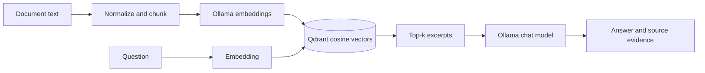

# V0.1 architecture

## Trust boundaries

- FastAPI uses an API-key header on ingestion and question endpoints. Keep server bound to localhost unless behind an authenticated reverse proxy.
- Only synthetic or explicitly licensed data belongs in this demo.
- Retrieved text is untrusted; prompt-injection hardening remains an area for further work.
- Citations are model-generated pointers, not independently verified proof. The API returns actual retrieved source excerpts for inspection.
- Model outputs can be wrong. This system is a portfolio prototype, **not production ready**.

## Roadmap

1. Structured PDF/DOCX ingestion with provenance and document versioning.
2. Hybrid BM25 + dense retrieval, reranking, evaluation harness (precision@k, recall@k, faithfulness), and observability.
3. Per-document RBAC and identity-aware retrieval to prevent cross-tenant data leakage.
4. TLS, OpenID Connect, rate limiting, audit trails, deletion, and secret management.
5. Benchmarks on single and multiple GPUs; deployment comparison with managed cloud services.
