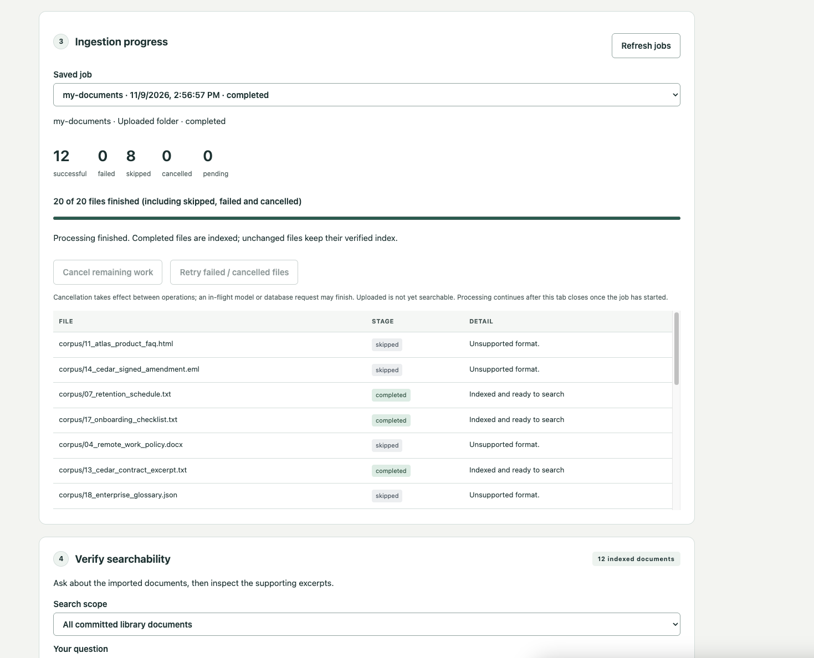
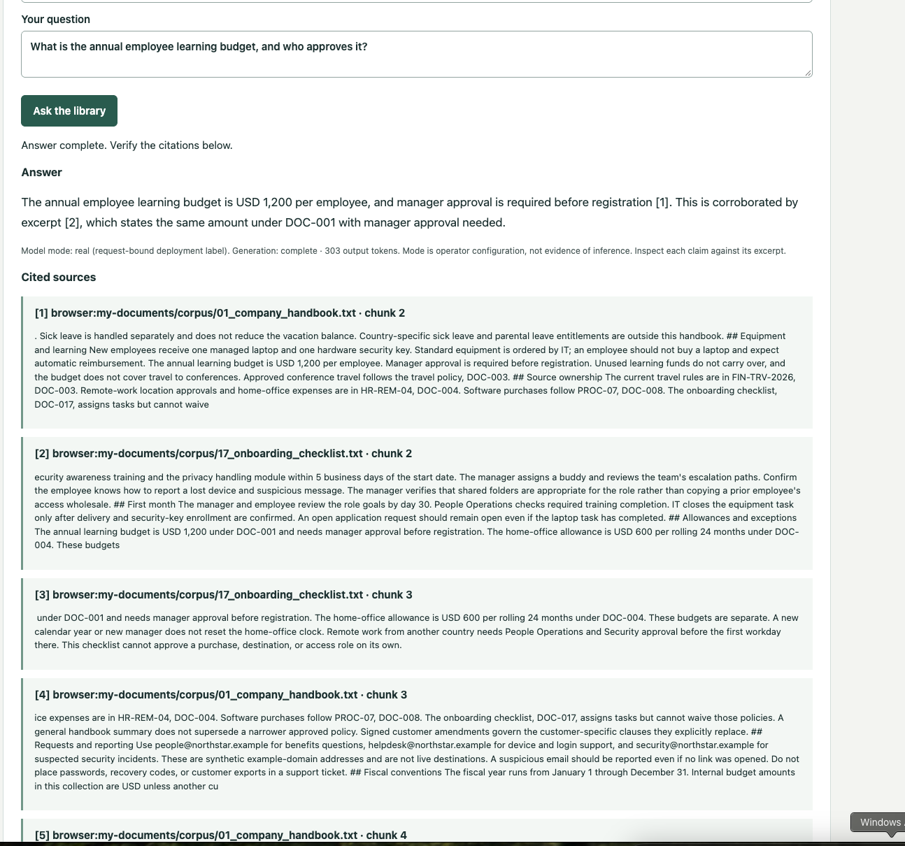
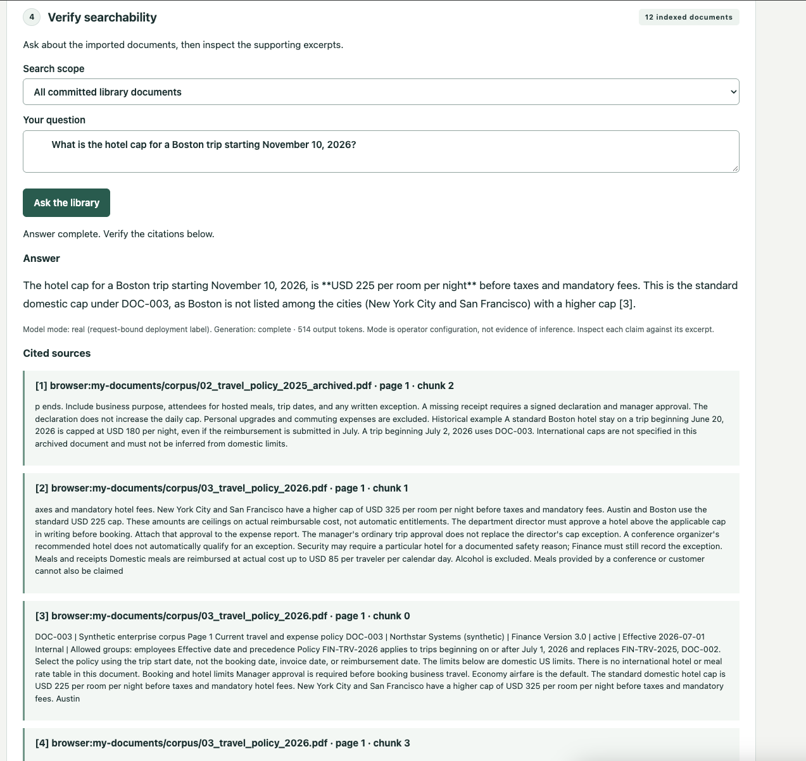
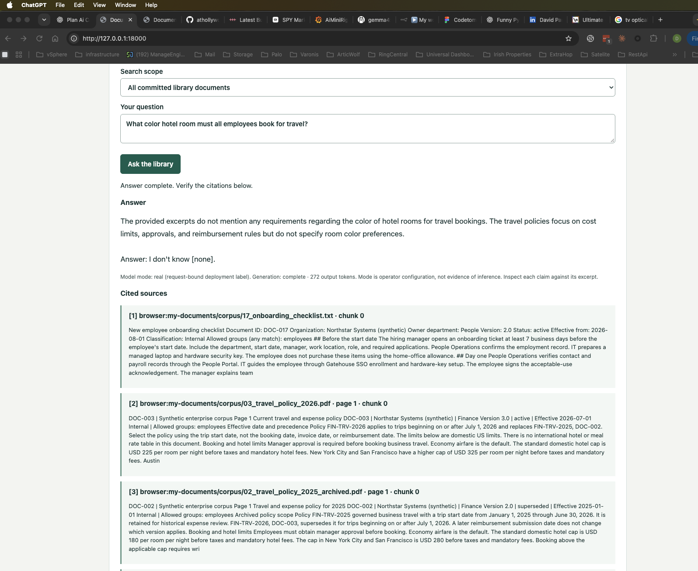

# Linux ARM64 manual smoke screenshots — 2026-11-09

These maintainer-provided screenshots preserve a manual installation and browser test on an Ubuntu 24.04.5 ARM64 virtual machine. The documents are a **synthetic enterprise sample corpus**; the displayed answers came from the maintainer's real Ollama installation, not the synthetic response fixture.

The installer reported CPU mode, chat model `qwen3:8b`, and embedding model `nomic-embed-text:latest`. Successful answers were observed after increasing the VM to 16 GB RAM and 8 virtual CPUs. This is one observed configuration, not a measured minimum or a performance guarantee.

## Gallery

### Folder ingestion completed

The UI reports 20 selected files: 12 indexed, 8 skipped, no failures, and no pending work. Visible skipped examples include unsupported HTML, EML, DOCX, and JSON. The selected supported files included TXT, CSV and text-based PDFs; the screenshot does not independently verify every file's contents.

### Supported answer from TXT documents

Question: “What is the annual employee learning budget, and who approves it?”

The answer gives USD 1,200 per employee annually, with manager approval before registration. Both visible cited excerpts support those claims. The UI reports generation complete.

### Current policy selected with an archived PDF also retrieved

Question: “What is the hotel cap for a Boston trip starting November 10, 2026?”

The answer gives USD 225 per room per night before taxes and mandatory fees. The current policy excerpt applies to trips beginning on or after July 1, 2026; another excerpt explicitly places Boston under the standard cap. The older USD 180 rule was retrieved but was not incorrectly used. PDF page and chunk provenance are visible.

### Missing information acknowledged

Question: “What color hotel room must all employees book for travel?”

The answer says the provided excerpts contain no room-color requirement and ends with “I don't know [none].” This demonstrates abstention for this question, not a guarantee across unanswerable questions.

## Evidence boundaries

- These are supplied screenshots, not independently collected HTTP traces, raw model logs or a reproducible evaluation report.
- The maintainer also observed the 12 documents still listed after stopping the application, rebooting the VM, and resuming setup. The successful answers followed that restart; this is a manual recovery observation.
- An earlier question failed while the smaller VM was under substantial memory pressure. The underlying error was not captured in the supplied answer view, so the cause remains unconfirmed.
- The displayed model-mode label alone is configuration, not proof of inference. The real-model description above relies on the maintainer's installation and process observations as well as the displayed responses.
- Exact running source/image digests, request counts, timings and broad retrieval quality were not independently verified for this session. No CSV-specific answer is shown.
- This session is separate from the earlier live UI attempt 3. Its formal FAILED_INCOMPLETE status due to partial log capture remains unchanged; its verified shutdown and accepted answers remain separate historical evidence.
- No application rerun, model inference or deployment was performed to add this gallery.

## Reuse and handling

Images retain their original screenshot pixels, including partial excerpts and UI imperfections. Embedded EXIF/text metadata was removed; no answers or citations were edited. Screenshots exposing the application key were excluded. Use these captions when reusing the images so real model responses are not confused with real organizational data. Checksums below apply to these repository copies.

## Follow-ups observed during manual setup

- Add a README-linked Ubuntu Docker Engine, Compose and Buildx installation guide covering ARM64 and x86-64, permissions and verification.
- Document observed VM memory pressure and CPU limitations without presenting one successful allocation as a universal minimum.
- Keep question failure details next to the question instead of referring to an error that is not visible there.
- Handle literal Markdown markers in model answers safely.
- Distinguish retrieved excerpts from references actually cited by the answer, particularly when it abstains with `[none]`.

These are follow-up items; this change only preserves evidence.
