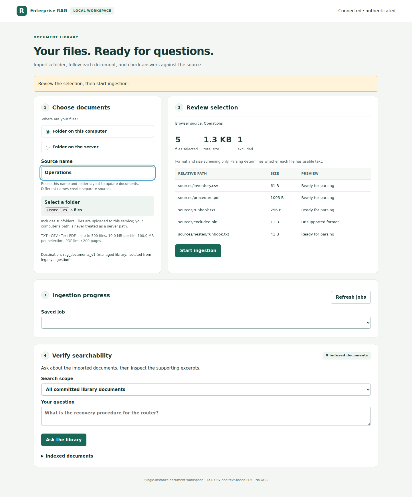
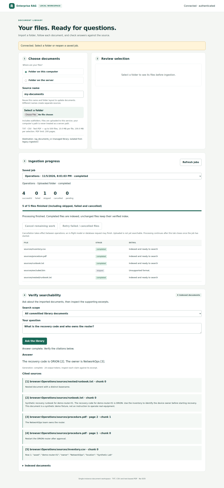

# Reviewing the folder UI

The interface is served at `/` by the same Docker API. Follow
[the setup guide](folder-library.md), connect with your configured key, and use
this small review sequence:

1. Select a folder containing `runbook.txt`, `inventory.csv`, a text-based PDF,
   two nested files with the same basename, and an unsupported file.
2. Inspect file count, total size and the unsupported-file exclusion. Start.
3. Observe staged uploads followed by parsing, chunking, embedding and indexing.
   Refresh, reconnect and reopen the job. Counts and per-file results persist.
4. Ask a fact question, check source relative paths and PDF page numbers, and read
   the excerpt supporting each citation. Generation completion is shown separately.
5. Reingest the same folder: unchanged compatible documents skip. Change one file:
   its new revision replaces the old only after successful indexing. Remove one
   file from the selection: its previously indexed document remains.
6. Configure a read-only server mount using `compose.sources.example.yaml`. Browse
   within its label, preview the subtree and ingest through the same parser.
7. Cancel a larger job and observe that the in-flight operation can finish before
   cancellation is observed. Retry failed/cancelled files explicitly.

## Automated browser walkthrough

`scripts/ui_browser_check.py` drives the actual HTML/JS with Chromium and the real
FastAPI/job/parser implementation. `demo/serve_ui_fixture.py` supplies a temporary
SQLite registry and local-mode Qdrant with **synthetic model replies**; it cannot
be used as proof of live-model quality. The fixture server binds localhost only.

The `browser-workspace` CI job checks folder selection/upload, completed results,
refresh recovery, question/citation display, server browsing, keyboard focus and
390px viewport overflow. Its `actual-ui-screenshots` artifact contains preview,
results, server-source and mobile screenshots. The separate `container-smoke` job
uses a real Qdrant server and parsers from inside the built Docker image.

`node --test demo/ui_selection.test.cjs` also exercises the shipped JavaScript
with deterministic DOM/fetch fixtures: reordered previews, source edits, mode/root
changes, stale browse results and an upload set captured before an in-flight create.
These are race regressions, not an additional real-browser run. The API independently
checks the displayed preview's digest against the current server inventory.

The execution workspace used for implementation cannot launch Chromium (its Unix
socket syscall is denied), and has no Docker daemon. CI performs those isolated
checks instead. The source is not deployed to shared n8n or AiMiniRig, and no real
model inference is performed by these tests.

## Captured experience

These are screenshots of the actual application at `ce1d133`, captured by
[the successful Chromium run](https://github.com/athollywood2002/enterprise-rag-platform/actions/runs/42099229864).
They use only public synthetic fixtures. Model responses are synthetic; the
browser, HTTP API, parser subprocesses, SQLite worker and local Qdrant are real.

### Preview before uploading

Five selected files include nested duplicate basenames, CSV, a two-page text PDF
and one excluded binary file. The preview reports counts, bytes and exclusions.

### Results recovered after refreshing

Four documents completed, one unsupported file skipped. The answer's ORION and
NetworkOps claims cite source excerpts, including physical PDF page provenance.
This verifies the data flow and citation presentation, not model quality.

[Server-folder screenshot](images/server-folder.png) ·
[390px mobile screenshot](images/mobile-library.png)

## Recorded validation

| Layer | Result | Evidence scope |
| --- | --- | --- |
| Focused ingestion suite | 39 passed | Real SQLite, local Qdrant and parser children; mocked model and injected parsing/embedding/indexing/cleanup failures, model changes, quotas, cancellation and restart boundaries. |
| Base Python suite | 765 passed, 43 skipped, 4 subtests passed | Optional legacy parser tests intentionally skipped in the base environment. Ruff check and format passed. |
| Optional document suite | 808 passed, 4 subtests passed | Existing legacy document/API coverage plus the new library tests. |
| Docker integration | Passed | Real built image and digest-pinned Qdrant; TXT/CSV/PDF parsing, idempotency, replacement, source containment, failure recovery, cited answer, interrupted API restart and retry. Synthetic Ollama. |
| Chromium | Passed | Folder selection/upload, source-name preview invalidation, actual ingestion, refresh/reconnect, answer/citations, server browse, 390px layout, keyboard focus, no JavaScript errors. |
| Existing n8n contract | 5 passed | Exported Code-node harness and old API smoke. No new execution in a live n8n instance. |
| Real-model observations for this PR | None | Historical accepted n8n/PDF smokes remain closed and separate. |

[Base and optional parser CI](https://github.com/athollywood2002/enterprise-rag-platform/actions/runs/42098843826)
· [container/restart and Chromium evidence](https://github.com/athollywood2002/enterprise-rag-platform/actions/runs/42098843720).
The PR checks show the latest exact-head results; the runs above retain the
recorded implementation evidence. No test here is a retrieval-quality benchmark.

## Review without contacting a real model

Use the README's **Offline and synthetic container checks**, with a fresh Compose
project name and an unused loopback port (set `RAG_PORT` if 18000 is occupied).
That override points only to the local synthetic Ollama container. Open the UI,
connect using the disposable test key from those commands, and select
`demo/fixtures` on your computer or the `fixture-root` server root. Ingest, then ask
“What is the recovery code for demo-router-01 and which team owns it?”
Inspect ORION, NetworkOps and their cited excerpts. Other questions can produce
fixture-specific replies; this is an interface/protocol review environment.

For real Ollama use, follow the operating guide with an authorized isolated model
endpoint. Nothing in this PR authorizes a new shared-host or AiMiniRig run.
The local build tag is `enterprise-rag-platform:folder-ui-v1`; it is not published.
